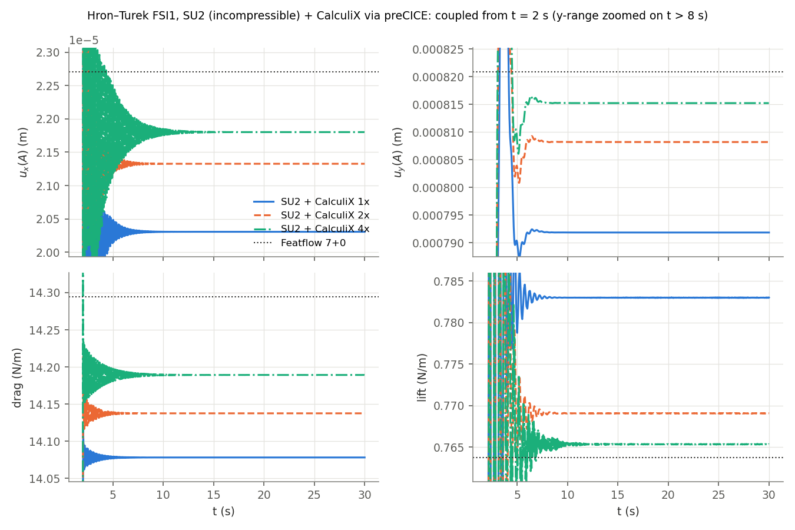

# Hron–Turek FSI1 with preCICE: SU2 fluid + CalculiX solid (November 2026)

This is an independent-code solution of FSI1 (issue #36). The fluid code (SU2, a vertex-based finite volume solver), the solid code (CalculiX, finite elements) and the coupling library (preCICE) are all independent of solids4foam, so the route is fully independent.

The case is the preCICE OpenFOAM + CalculiX case of `../fsi1_precice_calculix` (#75) with only the fluid code swapped: the same fluid meshes (node-identical), the same CalculiX plate, Δt, coupling scheme, tolerances and mapping. Differences between the two routes therefore come from the fluid discretisation.

## Platform

- **Machine:** AMD Ryzen Threadripper PRO 9985WX workstation (64 cores, 251 GiB), Ubuntu 24.04.5, GCC 13.3.0, Open MPI 4.1.6, Python 3.12.3. Jobs ran through Slurm with dedicated cores.
- **Fluid:** SU2 7.5.1 (`INC_NAVIER_STOKES`), built from source with MPI and the Python wrapper, with the preCICE SU2 adapter (`precice/su2-adapter`, commit `fde3106`). SU2 7.5.x is the only release the adapter supports. The build uses the adapter's two replacement files (`CDriver.hpp`, `python_wrapper_structure.cpp`) and one extra line for GCC 13 (`scripts/su2-7.5.1-cstdint.patch`).
- **Solid:** CalculiX 2.20 (`ccx_preCICE`, adapter 2.20.2, Ubuntu noble package `calculix-precice3`).
- **Coupling:** preCICE 3.5.0 (`libprecice3`), pyprecice 3.5.0.
- **Environment:** `scripts/env-su2-precice.sh`. `OMPI_MCA_osc=^ucx` is needed: with Open MPI 4.1.6, the UCX one-sided component makes `SU2_CFD` abort in `MPI_Win_create`.

## Set-up

- **Fluid mesh:** the `TurekHron2006` fluid blockMesh of #75 (`../fsi1_precice_calculix/case/fluid-openfoam/system/blockMeshDict`), with every in-plane block division multiplied by the level, meshed by OpenFOAM `blockMesh` and converted to a 2-D `.su2` mesh (`scripts/make_fluid_mesh.py`). The nodes are those of #75: 5 336, 21 344 and 85 376 quadrilaterals at 1x, 2x and 4x. SU2 is vertex-based (median-dual control volumes around the nodes), so the same nodes are not the same discretisation as OpenFOAM's cell-centred one.
- **Fluid settings** (`case/fluid-su2/*.cfg`):
  - ν = 1e-3 m²/s, ρ = 1000 kg/m³ (μ = 1 Pa s), dimensional incompressible solver, constant density.
  - Parabolic inlet with a 0.3 m/s maximum (mean 0.2 m/s), prescribed at the inlet nodes (`scripts/make_inlet_profile.py`). Outlet at p = 0, no-slip walls.
  - Flux-difference splitting (FDS) with MUSCL reconstruction and no limiter, weighted-least-squares gradients, default `BETA_FACTOR` (see the β section).
  - Second-order dual time stepping (BDF2), Δt = the coupling window. Each physical step is solved in pseudo-time with implicit Euler, CFL 1000, FGMRES + ILU (1e-8), up to 200 inner iterations, stopped when the RMS residuals of pressure and both velocity components are below 1e-9 (absolute, log10 = −9).
  - Mesh motion: linear elasticity with wall-distance stiffness; only the plate moves.
- **Solid** (`case/solid-calculix/`): unchanged from #75 except the slab depth.
  - CalculiX `*DYNAMIC` with `NLGEOM` and `*ELASTIC`, which is exactly St Venant–Kirchhoff. E = 1.4 MPa, ν = 0.4, ρ = 1000 kg/m³.
  - (105·L) × (6·L) × 1 C3D8I elements with u_z = 0 (plane strain), clamped on the cylinder face, quasi-2D coupled through the adapter.
  - The slab is 1 m deep instead of 0.015 m, because SU2 forces are per metre depth and the quasi-2D adapter applies the 2-D nodal force to the whole slab. A static `NLGEOM` check with a tip load scaled with the depth gives identical displacements (7 digits) for 1 m and 0.015 m.
- **Start-up protocol:** SU2's Python interface cannot change the inlet velocity in time, so the 0–2 s inlet ramp with a rigid plate of #75 and solids4foam is replaced by a **steady rigid-plate solution** (the CFD1 problem; `steady_rigid.cfg`, residuals below 1e-12). The coupled run restarts from it at t = 2 s (both BDF2 levels set to it) and runs to t = 30 s with Δt = 0.025 s at 1x and 2x and 0.0125 s at 4x, as #75.
- **Coupling** (`case/precice-config.base.xml`): as #75.
  - preCICE parallel-implicit with IQN-ILS (residual-sum preconditioner, QR2 filter 1e-3, 10 reused windows, initial relaxation 0.1).
  - Relative convergence limit 1e-6 on both force and displacement, at most 50 iterations.
  - RBF mapping with the compact C6 basis and a 0.03 m support, conservative for force and consistent for displacement.
  - One difference: SU2 provides a single vertex mesh (the plate nodes) for both force and displacement, where OpenFOAM provides face centres for force and face nodes for displacement.
- **Evaluation** (`scripts/evaluate_fsi1.py`, `scripts/study_table.py`), as #75:
  - Point A from a preCICE watch-point at (0.6, 0.2).
  - Drag and lift on cylinder + plate from SU2's force coefficients, which equal the forces in N/m (force reference ½ρU²·A_ref = 1); the converged (last) solve of each window.
  - Each quantity is the **mean** over the closing 20 % of the run (t = 24.4–30 s); the steadiness test is the solids4foam one (relative spread below 1e-3).

## Mesh study (fluid and solid refined together)

| Quantity | 1x | 2x | 4x | Featflow 7+0 |
|---|---:|---:|---:|---:|
| u_x(A) (m) | 2.03054e-5 | 2.13263e-5 | 2.18016e-5 | 2.270493e-5 |
| u_y(A) (m) | 7.91863e-4 | 8.08211e-4 | 8.15246e-4 | 8.208773e-4 |
| drag (N/m) | 14.0781 | 14.1376 | 14.1892 | 14.29426 |
| lift (N/m) | 0.782993 | 0.769069 | 0.765339 | 0.7637460 |

| Quantity | Error 1x / 2x / 4x | Observed order | Richardson value | vs Featflow | vs #75 Richardson | vs solids4foam Richardson | GCI (4x) |
|---|---:|---:|---:|---:|---:|---:|---:|
| u_x | −10.57 / −6.07 / −3.98 % | 1.10 | 2.22154e-5 | −2.16 % | −2.66 % | −2.67 % | 2.37 % |
| u_y | −3.53 / −1.54 / −0.69 % | 1.22 | 8.20562e-4 | −0.04 % | +0.30 % | +0.28 % | 0.81 % |
| drag | −1.51 / −1.10 / −0.73 % | 0.20 | not in the asymptotic range | – | – | – | – |
| lift | +2.52 / +0.70 / +0.21 % | 1.90 | 0.763975 | +0.03 % | +0.09 % | +0.10 % | 0.22 % |

GCI with a safety factor of 1.25, as in `../fsi1_four_level`. The #75 and solids4foam Richardson values are 2.2823e-5 / 8.1813e-4 / 14.3006 / 0.76330 and 2.2824e-5 / 8.1825e-4 / 14.3026 / 0.76318.

- **u_y and lift** converge monotonically and their Richardson values agree with #75 and solids4foam to 0.3 % and 0.1 %.
- **u_x** converges monotonically at first order. Its Richardson value is 2.7 % below #75 and solids4foam, slightly more than its GCI (2.4 %). The error is larger than with the OpenFOAM fluid at every level (#75: −1.88 / −0.69 / −0.09 %).
- **Drag** errors decrease monotonically, but the observed order is 0.20, so the 4x value (−0.73 %) is reported **without extrapolation**. The steady rigid-plate solutions below explain this: the viscous part of the drag converges at first order and the pressure part at about second order, with errors of opposite sign, so their sum is not in the asymptotic range of either.
- An interpretation: u_x(A) is mostly the axial stretching of the plate under the drag on it, much of which is wall shear, so it plausibly inherits the first-order wall-shear convergence; u_y and lift are pressure-dominated and converge faster.
- With final values instead of closing-20 % means, the observed orders and Richardson values are the same to the digits shown.
- All four quantities pass the 1e-3 steadiness test on every run. The largest spread is 9.9e-5 (lift, 2x); the displacement spreads are at most 2.1e-5 (u_x, 4x).



The u_x and drag histories show a step-to-step oscillation up to about t = 10–15 s, while the inner solves are still capped (see the protocol section). It has decayed long before the averaging window.

## Steady rigid-plate solution (CFD1) and the drag convergence

The start-up solution is the Turek–Hron CFD1 problem (rigid plate, Re = 20). Default `BETA_FACTOR`, residuals below 1e-12 (`beta/cfd1_steady_rigid.csv`):

| Level | Fluid cells | Drag (N/m) | Lift (N/m) | Viscous drag (N/m) | Pressure drag (N/m) |
|---|---:|---:|---:|---:|---:|
| 1x | 5 336 | 14.0776 | 1.13887 | 6.2598 | 7.7155 |
| 2x | 21 344 | 14.1367 | 1.12434 | 6.4798 | 7.5933 |
| 4x | 85 376 | 14.1882 | 1.12024 | 6.5938 | 7.5557 |
| 8x | 341 504 | 14.2273 | 1.11912 | 6.6522 | 7.5511 |
| CFD1 reference | | 14.29 | 1.119 | | |

- Lift converges at about second order to the CFD1 value.
- The viscous drag changes by 0.220, 0.114 and 0.058 N/m between successive levels, a ratio of 1.9–2.0: **first order**, on both the cylinder and the plate. The pressure drag converges faster (about second order) and from above. Green–Gauss gradients instead of weighted least squares give the same first-order viscous convergence.
- The viscous/pressure split is a post-processing integral of SU2's nodal wall pressure and skin friction over the marker edges (`scripts/split_drag.py`, trapezoidal rule). Its total is 0.2–0.8 % below SU2's own drag, so it is used only for the changes between levels.

## SU2's `BETA_FACTOR` is part of the discretisation

SU2's incompressible solver uses artificial compressibility with a preconditioned flux-difference splitting. In SU2 7.5.1, β² = max(4.1, `BETA_FACTOR`) · max|u|², and β² sets the preconditioned wave speed in the upwind dissipation of the pressure–velocity coupling. The physical-time term has no artificial ∂p/∂t (the continuity entry is the constant density). So β changes the discrete equations, not only the convergence path, and converged solutions, steady and unsteady, depend on it.

**Steady CFD1 at 1x:** drag 14.0776 N/m at the default (4.1) and 14.8412 N/m at β = 100, lift 1.13887 and 1.16588 N/m (+5.4 % and +2.4 %; both converged below 1e-12).

**One coupled time step at 1x**, solved in SU2 alone (no preCICE) with the interface displacement that the coupled run received in the third coupling iteration of its first window (`scripts/prescribed.py`, `beta/single_step_replay.csv`):

| β factor | Converged drag (N/m) | Converged lift (N/m) | Inner its to residual 1e-9 | to 1e-10 | Drag within 1e-6 of its final value after |
|---:|---:|---:|---:|---:|---:|
| 4.1 (default) | 13.985 | −12.610 | 2 193 | 2 751 | 1 838 |
| 20 | 14.296 | −12.674 | 998 | 1 258 | 769 |
| 100 | 14.917 | −12.758 | 268 | 387 | 126 |
| 500 | 16.236 | −12.890 | 242 | 296 | 158 |
| 2000 | 18.549 | −13.076 | 141 | 168 | 89 |

- At the default β a step after a sizeable plate movement needs about 2 200 inner iterations to reach 1e-9, 11 times the 200-iteration cap.
- A larger β converges faster but to a different solution: the converged drag of this step rises by 33 % from β = 4.1 to 2000.
- All results here use the default β. For FSI1 this is sufficient because the reported values are the steady end state (next section). For an unsteady case such as FSI3, where the transient is the result, every inner solve would have to converge at the default β, at roughly ten times the cost per step; FSI3 with SU2 is out of scope for this reason. The rigid-flag CFD3 runs in the next section measure what β does to a shedding flow.

## CFD3 (rigid flag, unsteady): β in a shedding flow

The CFD3 problem (the FSI3 fluid with a rigid flag) solved by SU2 alone, to measure the effect of β when the transient is the result. Everything is in `cfd3/`.

**Set-up** (`cfd3/case/cfd3.cfg`, `cfd3/scripts/setup_cfd3.py`):
- The FSI1 meshes above at 1x and 2x (5 336 and 21 344 cells, node-identical to the paper's CFD3 sequence), with the flag a rigid no-slip wall.
- ρ = 1000 kg/m³, μ = 1 Pa s. Parabolic inlet with a 3 m/s maximum (mean 2 m/s), impulsive start from u = (2, 0) m/s.
- Fluid settings as FSI1 (FDS + MUSCL, no limiter; BDF2 dual time stepping; implicit Euler in pseudo-time, CFL 1000, FGMRES + ILU). Δt = 1e-3 s at both levels.
- Inner solves stop when the RMS residuals of pressure and both velocity components are below 1e-9, or at a cap of 40, 200 or 300 inner iterations (per run, below).
- Drag and lift on cylinder + flag in N/m (force reference ½ρU²·A_ref = 1).
- **Protocol.** From the impulsive start, inner solves do not converge in an affordable number of iterations: in a 1x pilot every step hit a 1 000-iteration cap with rms[u] at about 1e-5.5 (`histories/pilot-L1.csv`, 45 steps, cancelled). So each level was first run to t = 8 s with 40 inner iterations per step (`dev-*-cap40`, deliberately under-converged). Runs with the inner solves converged (or at a 200–300 cap) were then restarted from the two BDF2 levels at t = 8 s with the β and scheme under test.
- **Evaluation** (`cfd3/scripts/evaluate_cfd3.py`, `osc_growth.py`, `cfd3_table.py`):
  - For shedding runs, the Turek–Hron quantities over the last 4 complete lift periods: mean = (max + min)/2, amplitude = (max − min)/2, frequency = 1/period, with extrema by parabolic interpolation.
  - For decaying runs, the growth per shedding period: the lift minus its moving average over one period, half-range per 0.5 s window, a least-squares fit of log(half-range) against time, expressed per Featflow period (0.2275 s).

**1x: SU2 does not shed** (restarts from the cap-40 state at t = 8 s, run to t = 11 s, inner cap 200):

| Run | β factor | Scheme | Lift oscillation per period | Lift half-range, first → last 0.5 s (N/m) | Steady drag (N/m) | Steady lift (N/m) |
|---|---:|---|---:|---|---:|---:|
| `diag-L1-b4.1` | 4.1 (default) | FDS | none (steady) | 3e-5 → 1e-4 (solver noise) | 461.00 | −9.81 |
| `diag-L1-b20` | 20 | FDS | × 0.50 | 3.7 → 0.04 | 488.82 | 23.93 |
| `diag-L1-b100` | 100 | FDS | × 0.27 | 3.1 → 6e-4 | 561.54 | 39.50 |
| `diag-L1-jst` | 4.1 | JST | × 0.25 | 1.6 → 2e-4 | 467.74 | 33.45 |

- At the default β the cap-40 start-up run already decays (× 0.74 per period, from a 1.1 N/m oscillation at t = 0.5–1 s to 1.5e-4 N/m at t = 7–7.5 s), and the converged continuation stays steady (inner solves converge in 16 iterations on average). Its decay rate with converged inner solves is therefore not measured; the flow is steady either way.
- The β = 20 and 100 and JST runs start from the β = 4.1 steady state; the change of β or scheme perturbs the flow, and the perturbation rings down at the shedding frequency. A larger β damps it faster.
- β also moves the steady solution: drag 461.0 → 488.8 → 561.5 N/m (+6 % and +22 %) from β = 4.1 to 20 and 100.
- In these three runs the inner solves sit at the 200 cap: median rms[u] 1e-6.7 to 1e-7.3 over the run and 1e-7.2 to 1e-8.1 in the last second.
- For comparison, solids4foam at 1x (Δt = 1e-3 s) sheds with a lift amplitude of 296 N/m (`../hronturek_cfd3_runs.csv`).

**2x: SU2 sheds.** Restarts from the cap-40 state at t = 8 s (already shedding), run to t = 10 s with a 300-iteration cap. Values over the last 4 lift periods (t ≈ 9.06–9.97 s):

| Run | β factor | Drag mean ± amp. (N/m) | Lift mean ± amp. (N/m) | f (Hz) | Lift oscillation per period |
|---|---:|---|---|---:|---:|
| `conv-L2-b4.1` | 4.1 (default) | 446.15 ± 3.24 | −18.04 ± 351.0 | 4.3859 | × 1.001 (periodic) |
| `conv-L2-b20` | 20 | 452.11 ± 2.44 | −18.95 ± 270.3 | 4.3553 | × 0.974 (still decaying) |
| `dev-L2-cap40` (40 inner its) | 4.1 | 446.42 ± 3.64 | −18.45 ± 361.4 | 4.3865 | |
| solids4foam 2x, Δt 5e-4 s | | 441.81 ± 5.53 | −18.98 ± 424.4 | | |
| Featflow | | 439.45 ± 5.62 | −11.89 ± 437.81 | 4.3956 | |

- **β is part of the discretisation here too.** From β = 4.1 to 20 the lift amplitude falls by 23 % (351.0 → 270.3 N/m, and still decaying), the drag mean rises by 1.3 % and the frequency falls by 0.7 %.
- **SU2 is more dissipative than solids4foam on the same nodes.** Its 2x lift amplitude (351 N/m, −17 % against solids4foam 2x) lies between solids4foam's 1x (296) and 2x (424). The frequency is within 0.22 % of Featflow.
- **Inner convergence.** At 2x the inner solves stop at the 300 cap at every step, at a median rms[u] of 1e-6.5 (β = 4.1) and 1e-6.9 (β = 20), and rms[p] of 1e-7.6 and 1e-8.2. The 40-iteration run differs from the 300-iteration run by 3.0 % in lift amplitude and 0.06 % in drag mean, so the remaining inner-iteration error is probably below that but not zero.
- **Time step.** Δt = 1e-3 s at 2x, not the 5e-4 s of the paper's matched sequence. solids4foam's 2x lift amplitude changes by 0.2 % from Δt = 5e-4 to 2.5e-4 s; the Δt sensitivity of SU2 was not measured.

**Cost** (`cfd3/cfd3_su2.csv`):

| Run | Cores | Wall clock (s) | s per step | Core-hours per simulated second |
|---|---:|---:|---:|---:|
| 1x, 200 inner its (`diag-L1-b20`) | 4 | 6 043 | 2.01 | 2.2 |
| 2x, 300 inner its (`conv-L2-b4.1`) | 16 | 8 668 | 4.33 | 19.3 |
| 2x, 40 inner its (`dev-L2-cap40`) | 8 | 11 518 | 1.44 | 3.2 |
| solids4foam 2x, Δt 5e-4 s (`../hronturek_cfd3_runs.csv`) | 8 | 5 136 for 25 s | 0.10 | 0.46 |

At 2x SU2 costs about 40 times more than solids4foam per simulated second, with half as many time steps and inner solves that are still not converged to 1e-9. A coupled SU2 FSI3 would multiply this by the coupling iterations per window and need a finer mesh to shed at the right amplitude: roughly a day or more per coupled run.

## Coupled protocol: what is converged and what is not

- **Early transient under-converged.** At the 200-iteration cap, inner solves stop before reaching 1e-9 until t ≈ 9.5 s (1x), 8.1 s (2x) and 9.7 s (4x), that is, in the first ~27 % of the coupled time; there they stop at residuals between 1e-5 and 1e-8 (median about 1e-7.5 to 1e-8). These are 31.5 / 25.4 / 30.1 % of all solves (`scripts/inner_cap_stats.py`).
- **Steady end state converged.** In the closing 20 % every inner solve reaches 1e-9 (no capped solve; mean 6.2 / 3.6 / 11.1 inner iterations), and every coupling window converges.
- **Path independence of the end state.** The 1x run was repeated with an inner tolerance of 1e-7 instead of 1e-9 (`level1-innertol-7`), which converges the transient differently. The steady values agree with the 1e-9 run to 5–6 digits (u_x 2.030536e-5 in both; u_y 7.918612e-4 vs 7.918631e-4; drag 14.07812 in both; lift 0.782991 vs 0.782993). The 1e-7 tolerance leaves a force-noise floor at about the 1e-6 coupling tolerance: 14 coupling windows hit the 50-iteration cap, scattered to t = 28.7 s, and the lift spread is 8.0e-4. The production runs therefore use 1e-9.
- **Adapter checkpointing.** preCICE implicit coupling repeats a window from a checkpoint. With a prescribed plate motion in SU2 alone, a save–solve–reload–solve sequence reproduces a single solve to 1e-7 in drag and 6e-6 in lift.
- **Replay.** Solving the replayed step above with the coupled run's settings (200 inner iterations) reproduces the coupled solve to 8 significant digits (drag 13.99696983 vs 13.99696981). The coupled behaviour is therefore SU2's, not the coupling's.

## Cost and coupling

| Run | Wall clock coupled (s) | Steady start (s) | Cores (SU2 + CalculiX) | Core-hours (coupled) | Windows | Mean / max coupling its | Windows at cap |
|---|---:|---:|---:|---:|---:|---:|---:|
| 1x | 1 504 | 1 | 7 (6 + 1) | 2.9 | 1120 | 2.30 / 17 | 0 |
| 2x | 3 642 | 9 | 13 (12 + 1) | 13.2 | 1120 | 2.36 / 17 | 0 |
| 4x | 41 424 † | 71 | 25 (24 + 1) | 288 | 2239 | 3.36 / 50 | 2 (t = 8.26, 8.28 s) |
| 1x, inner tolerance 1e-7 | 964 | 2 | 7 (6 + 1) | 1.9 | 1120 | 4.93 / 50 | 14 |

† 4x: the time from the start of the coupled stage to the last completed window (2239 of 2240, t = 29.9875 s); see Notes.

The cost is almost all SU2 inner iterations during the transient (mean 70 / 60 / 78 inner iterations per solve over the whole run). #75's OpenFOAM fluid took about 20 core-hours at 4x (8 090 s on 9 cores), against 288 here. The two 4x windows at the coupling cap are in the transient and the run converges every window from t = 8.3 s on.

## Notes

- **4x final window:** CalculiX aborted inside its SPOOLES solver in the last of 2240 windows (`corrupted double-linked list`, heap corruption during the factorisation). #75 also had a SPOOLES abort in the last window of its 4x run, with a different message (`ChvManager_newObjectOfSizeNbytes`, negative size); the cause was not investigated. The 2239 completed windows converged, and the closing 20 % is steady, so the results are unaffected. The aborted processes did not exit and held the job until its 20 h limit (`logs/level4/slurm.out` stops after stage 1; `logs/level4/slurm.err` has the time-limit cancellation); that time is not the cost. `scripts/run-case.sh` has since gained a progress watchdog that stops both participants if no coupling window completes for 30 min (tested by stopping and by killing CalculiX on purpose); the runs here used only the original hang guard (stop the partner once one participant exits).
- **Adapter marker name:** the SU2 adapter hard-codes the coupled marker name `interface`, so `setup_case.py` renames the blockMesh `plate` patch. With any other name the adapter finds no fluid vertices and the forces are zero.
- **Unsteady inlet profile:** unsteady SU2 reads the inlet profile with a time-step suffix (`inlet_profile_00000.dat`); `run-case.sh` copies it.
- **Comparison with #75 per level:** on the same nodes, SU2 has the larger error against Featflow in every quantity at every level. At 4x it is within 0.3 % of #75 in u_y and lift, 0.7 % below in drag and 3.9 % below in u_x (`fsi1_su2_sweep.csv`, columns `*_vs_pr75`).
- **Correction to the #36 summary** (comment of 15 November): the inner solves stay capped in the first ~27 % of the coupled time, not ~10 %; a default-β step needs about 2 200 inner iterations to reach 1e-9, not 1 200–2 000; and the 4x CalculiX abort has a different message from #75's. None of this changes the results.

## Files

- `fsi1_su2_sweep.csv`: one row per run, with steady values, closing-window spreads, errors against Featflow and #75, coupling statistics, Slurm job, cores and cost.
- `histories/*.csv`: time histories of u_x(A), u_y(A), drag and lift (converged value per window) for the four runs.
- `fsi1_su2_histories.png`: the 1x/2x/4x histories with the Featflow values (`scripts/plot_histories.py`).
- `beta/cfd1_steady_rigid.csv`: the steady rigid-plate (CFD1) sequence, both gradient methods, the viscous/pressure split, and β = 100 at 1x.
- `beta/single_step_replay.csv`: the single-step β sensitivity.
- `case/`: the template: SU2 `steady_rigid.cfg` and `coupled.cfg`, CalculiX `plate.inp` and `config.yml`, and `precice-config.base.xml`. The `@…@` placeholders, meshes and inlet profiles are filled in by `scripts/setup_case.py`.
- `scripts/`:
  - `setup_case.py`: generates a case for a level (fluid mesh from the #75 blockMesh with `make_fluid_mesh.py`, inlet profile with `make_inlet_profile.py`, CalculiX mesh). It regenerates the 1x case used here byte for byte.
  - `run-case.sh`: Slurm batch script: stage 1 (steady rigid plate), stage 2 (coupled), timing, hang guard and watchdog.
  - `evaluate_fsi1.py`, `study_table.py`: the evaluation. `split_drag.py`, `inner_cap_stats.py`, `check_su2_mesh.py`: the diagnostics above. `prescribed.py`: SU2 alone with a prescribed or recorded plate motion (checkpoint and β tests).
  - `env-su2-precice.sh`, `su2-7.5.1-cstdint.patch`: the environment and build fix.
- `logs/<run>/`: the Slurm output (`slurm.out`), case summary, exit statuses, wall-clock times, the preCICE coupling-iteration log (`precice-Solid-iterations.log`), the preCICE watch-point log at point A (`precice-Solid-watchpoint-PointA.log`; its time counts from the start of the coupled stage, so add 2 s to match `histories/`), and the last lines of the solver logs. The repository `.gitignore` excludes `*.out` and `*.log`, so these files were added with `git add -f`. Full solver logs and field data are available on request.
- `cfd3/`: the CFD3 runs of the section above.
  - `cfd3_su2.csv`: one row per run, with settings, Slurm job, cores, wall clock, inner-iteration statistics, the lift-oscillation growth per period, the end values and, for shedding runs, the 4-period quantities with their deviations from Featflow and from solids4foam on the same mesh. Made by `scripts/cfd3_table.py` from `histories/` and `logs/`.
  - `histories/<run>.csv`: t, drag, lift (N/m), inner iterations and the final log10 RMS residuals of every time step. t = (time iteration + 1)·Δt is the physical time of the step's solution (SU2 resets its own time counter on a restart).
  - `case/cfd3.cfg`: the SU2 template; `scripts/setup_cfd3.py` fills it and copies the BDF2 restart files for a continuation; `scripts/run_cfd3.sh` is the Slurm script.
  - `scripts/evaluate_cfd3.py`, `osc_growth.py`: the evaluation, on a SU2 case folder or a published history.
  - `logs/<run>/`: Slurm output, case summary, exit status, wall clock and the SU2 screen log (`su2.log`, every 100th step). `pilot-L1` is the cancelled impulsive-start pilot.

To reproduce one level (Slurm; from a study directory holding `scripts/` and `case/` copied from here, with `paper-data/fsi1_precice_calculix` available for the blockMesh, OpenFOAM for `blockMesh`, and the paths in `scripts/env-su2-precice.sh` edited):

```bash
python3 scripts/setup_case.py 1 cases/L1
sbatch --ntasks=7 --mem=16G --time=02:00:00 --export=ALL,CASE=cases/L1 scripts/run-case.sh
python3 scripts/evaluate_fsi1.py cases/L1 --csv results.csv --hist-dir histories
```

To reproduce a CFD3 run (from `cfd3/`, with a 1x or 2x mesh made by `../scripts/make_fluid_mesh.py` as for FSI1):

```bash
python3 ../scripts/make_fluid_mesh.py ../../fsi1_precice_calculix/case/fluid-openfoam/system/blockMeshDict 2 fsi1_L2.su2
python3 scripts/setup_cfd3.py 2 fsi1_L2.su2 cases/dev-L2-cap40 --dt 1e-3 --t-end 8 --inner-iter 40 --write-every 1000
sbatch --ntasks=8 --mem=16G --time=06:00:00 --export=ALL,CASE=cases/dev-L2-cap40 scripts/run_cfd3.sh
python3 scripts/setup_cfd3.py 2 fsi1_L2.su2 cases/conv-L2-b4.1 --dt 1e-3 --t-end 10 --inner-iter 300 --write-every 500 \
    --restart-from cases/dev-L2-cap40 --restart-time 7.999
sbatch --ntasks=16 --mem=32G --time=06:00:00 --export=ALL,CASE=cases/conv-L2-b4.1 scripts/run_cfd3.sh
python3 scripts/evaluate_cfd3.py cases/conv-L2-b4.1 --cap 300
```

`--dt 1e-3` is needed at 2x (the script's default is the matched-sequence 5e-4 s). `--restart-time 7.999` selects the restart files of time iterations 7998 and 7999, i.e. the solution at t = 8 s.
